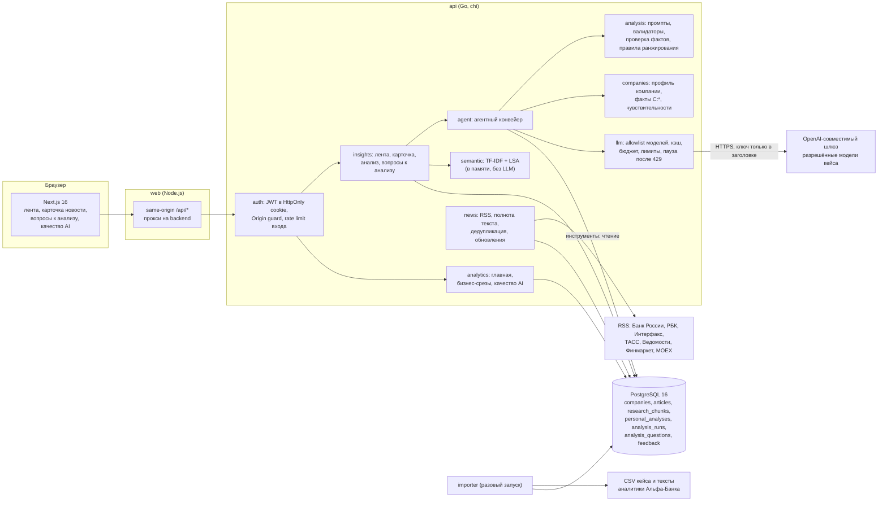
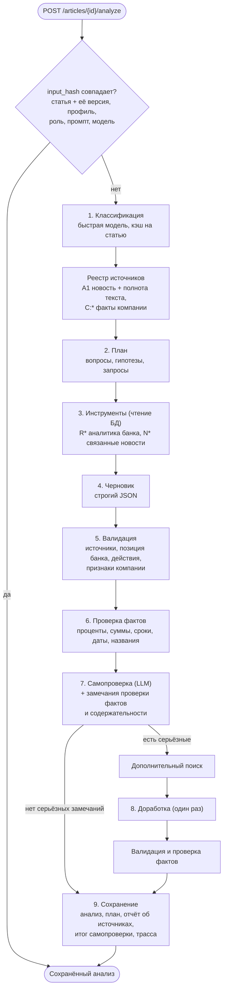
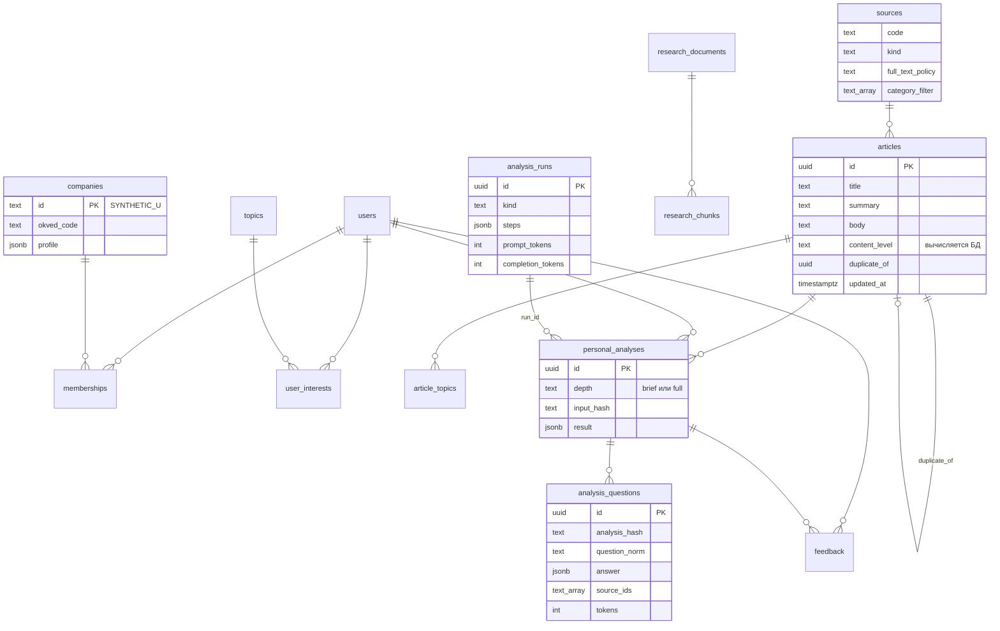

# Архитектура AlfaInsight

Документ описывает компоненты, агентный конвейер, модель данных, механизмы безопасности и подход к масштабированию. Как расширять систему — в [EXTENDING.md](EXTENDING.md), как выкатывать и откатывать — в [OPERATIONS.md](OPERATIONS.md), чек-лист развёртывания — в [DEPLOYMENT.md](DEPLOYMENT.md).

## Компоненты

| Компонент | Код | Назначение |
|---|---|---|
| Frontend | `frontend/src/features/*` | Пользовательский сценарий: онбординг, лента, карточка новости, анализ, трасса, вопросы, аналитика, качество AI |
| HTTP API | `backend/internal/server`, `insights`, `analytics`, `users`, `companies`, `auth` | REST API, контракт — `backend/api/openapi.yaml` |
| Агент | `backend/internal/agent` | Оркестрация шагов, инструменты поиска, кэш анализов, трасса |
| Аналитическое ядро | `backend/internal/analysis` | Промпты и JSON-схемы, валидаторы, проверка фактов, содержательность, правила ранжирования, отчёт трассы |
| Профиль компании | `backend/internal/companies` | Факты `C:*` из CSV и данных пользователя, чувствительности бизнеса |
| Клиент LLM | `backend/internal/llm` | Allowlist, кэш, объединение одинаковых запросов, дневной бюджет, лимиты частоты |
| Сбор новостей | `backend/internal/news` | RSS, нормализация, полнота текста, дедупликация, обновления публикаций |
| Семантика | `backend/internal/semantic` | Локальная модель TF-IDF + LSA для предварительного ранжирования |
| Утилиты | `backend/cmd/*` | `api`, `importer`, `llmcheck`, `eval`, `migrate` |

## Агентный конвейер

Модель вызывается только по действию пользователя. Фоновые задачи (RSS, темы по словарю, TF-IDF + LSA) работают без LLM.

Каждый шаг пишется в `analysis_runs.steps`: модель, токены, длительность, статус и структурированный результат. В трассу не попадают скрытые рассуждения модели: клиент отбрасывает блоки `<think>`, сохраняются только разобранные JSON-структуры.

Уточняющие вопросы (`POST /articles/{id}/analysis/questions`) работают поверх сохранённого анализа. Контекст ответа — анализ, план и его реестр источников. Два быстрых вопроса отвечаются без модели.

## Модель данных

`personal_analyses.result` хранит `insight` (выводы с `source_ids`, `used_company_factors`, `fact_check`, `source_coverage`, `source_completeness`), `plan`, `classification`, `sources_report`, `revision`, версию промпта и модели.

## Механизмы безопасности AI-компонентов

| Требование кейса (ограничение 06) | Реализация | Где в коде |
|---|---|---|
| Разграничение прав доступа | Все запросы, кроме входа и публичной витрины, требуют JWT в HttpOnly cookie. Анализы, трассы, вопросы и добавленные вручную новости доступны только владельцу: выборка всегда по паре «объект + текущий пользователь». Компания видна только её участникам | `auth/middleware.go`, `insights/handlers.go`, `agent/questions.go`, `companies/handlers.go` |
| Защита чувствительных данных | Секреты только в `.env`; ключ LLM передаётся только backend в заголовке `Authorization` и маскируется в логах; пароли — Argon2id; в логах HTTP только метод, путь и статус; данные кейса обезличены; публичная витрина не раскрывает пользователей и компании | `platform/config`, `llm/client.go`, `auth/password.go`, `server/server.go` |
| Контроль и журналирование обращений к инструментам | Каждый шаг агента (вызов модели или инструмента) с запросами, найденными источниками, моделью, токенами и статусом пишется в `analysis_runs`; вопросы к анализу — в `analysis_questions`; агрегаты — в `/analytics/quality` | `agent/agent.go`, `agent/questions.go`, `queries/analytics.sql` |
| Ограничение потенциально небезопасных действий | Инструменты агента выполняют только параметризованные запросы чтения к данным приложения; модель не формирует SQL и не вызывает внешние сервисы; ответы модели проходят валидацию (неизвестные источники, неподтверждённые числа и позиция банка удаляются); текст вопроса пользователя изолирован в промпте от инструкций; разрешены только модели из списка кейса | `agent.TSQuery`, `analysis/*`, `llm/allowed.go` |
| Контроль расхода | Дневной бюджет токенов и вызовов, лимит в минуту, почасовой лимит анализов, лимиты вопросов, пауза после 429 или ошибки бюджета, кэш и объединение одинаковых запросов | `llm/guard.go`, `llm/client.go`, `agent` |

## Масштабирование

**Новые отрасли, типы клиентов и источники** добавляются данными и небольшими справочниками, без изменения конвейера: отраслевые темы ОКВЭД, словарь тем, роли, источники с политикой полного текста, материалы банка. Пошагово — в [EXTENDING.md](EXTENDING.md).

**Нагрузка.**

- API почти без состояния: сессии и данные в PostgreSQL. В памяти процесса живут кэш LLM (6 часов), защита от двойного запуска анализа, счётчики минутного лимита и почасового лимита анализов, а также модель TF-IDF + LSA. При нескольких репликах эти счётчики нужно перенести в общий Redis или PostgreSQL. Дневной бюджет токенов уже пересчитывается из БД (`TokensUsedSince`) и переживает перезапуск.
- Сбор RSS запускается в процессе API. При нескольких репликах его нужно вынести в отдельный worker (`importer -news` по расписанию) и отключить `NEWS_FETCH_ENABLED` в API.
- Поиск по аналитике и новостям — полнотекстовый `tsvector` с GIN-индексами. Для больших корпусов в образе уже есть pgvector, на него можно перейти без смены СУБД.
- Расход LLM ограничен на уровне каждого шага (`max_tokens`). Полные анализы и ответы кэшируются по `input_hash`, в том числе между пользователями одной компании и роли.

**Качество при масштабировании** контролируется через holdout-evaluation (`backend/cmd/eval`) и мониторинг `/analytics/quality` с разбивкой по моделям и версиям промпта. Цикл описан в [OPERATIONS.md](OPERATIONS.md).
